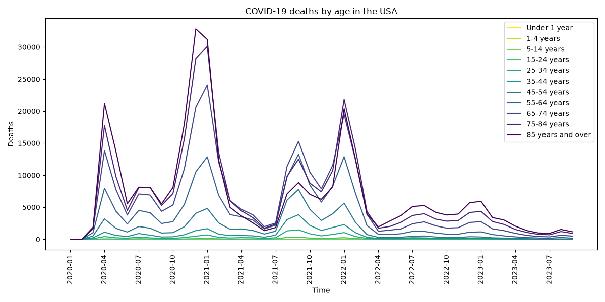

# Provisional COVID-19 Deaths by Sex and Age CDC API downloader and viewer
## Description
Python scripts that download a dataset from CDC via API and store it in a normalized SQLite database. It also creates a chart to visualize the data.
[Dataset](https://data.cdc.gov/National-Center-for-Health-Statistics/Provisional-COVID-19-Deaths-by-Sex-and-Age/9bhg-hcku/about_data)

Created for the capstone course of the *Python for everybody* specialization (University of Michigan, Coursera).
## Requirements
Created with Python 3.13.

Matplotlib library needed for the `analysis.py` script. (Run `pip install matplotlib` to install the library).

Database not included (it is created the first time the `python data_retrieve_json.py` script runs).
## Features
1. On running `python data_retrieve_json.py`, asks for two inputs:
    -   **URL**: press Enter to use this [dataset's endpoint](https://data.cdc.gov/resource/9bhg-hcku.json). Other data.cdc.gov endpoints will only work if they have the same fields.
    -   **Number of pages to download**: the API returns at most 1,000 rows per call, so data is downloaded in pages of 1,000 rows. Press Enter to download all pages.
2. Creates a db (`cdccovid.sqlite`) with 5 tables. Lookup tables avoid storing the same text many times.
    -   `age_group`: lists the 17 age groups.
    -   `metodo`: the API `group` field, i.e. whether the row covers the whole period, one year or one month.
    -   `sex`: Male, Female and All Sexes.
    -   `state`: the 54 jurisdictions (including "United States" and "New York City").
    -   `Dataset`: one row per record, with foreign keys to the four tables above and the death counts.
3. Death counts are stored as integers. Counts suppressed by the CDC for confidentiality (1–9 deaths) are stored as `NULL`.
4. Running the script again does not delete existing data: it counts the rows already stored and resumes the download from that point.

The full dataset contains 137,700 rows (54 states × 3 sexes × 17 age groups × 50 time periods). Data run from January 2020 to September 2023; the CDC stopped updating the dataset in September 2023.

## Analysis
On running `python analysis.py` it filters all the data in the database to get a chart that shows the COVID-19 monthly deaths by nationwide total (state = United States) and by group of age (11 groups, each one in a different color).

The dataset contains two different age groups distribution that overlap. For this analysis a distribution was chosen that covers all ages without overlapping.



## Usage
```
python data_retrieve_json.py
```
The database is created in the folder from which the script is run.
```
python analysis.py
```
On running creates a .PNG `covid_deaths_by_age.png` in the folder from which the script is run. It needs `data_retrieve_json.py` to run first in order to work.